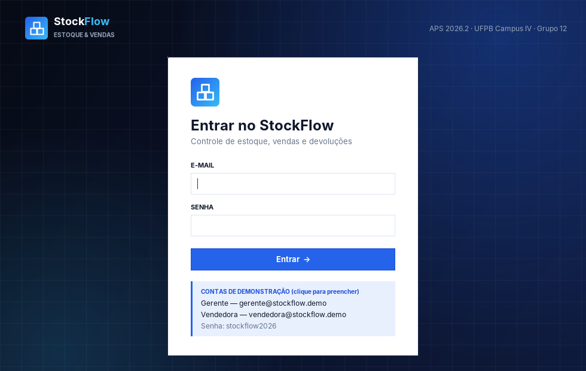
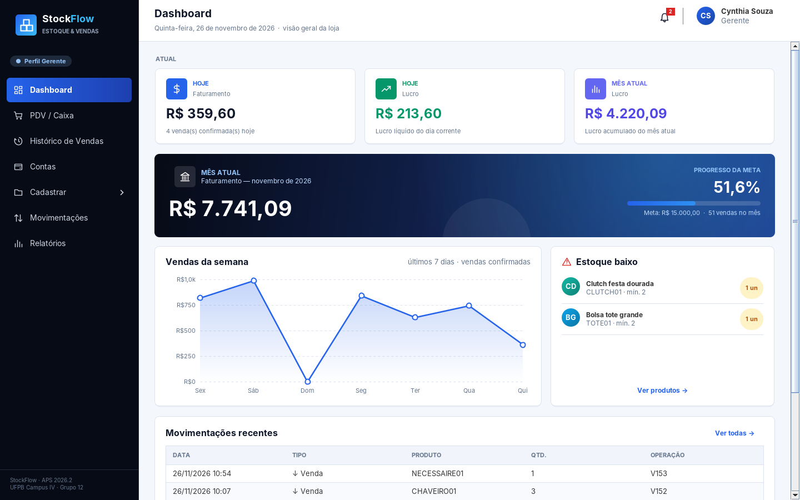
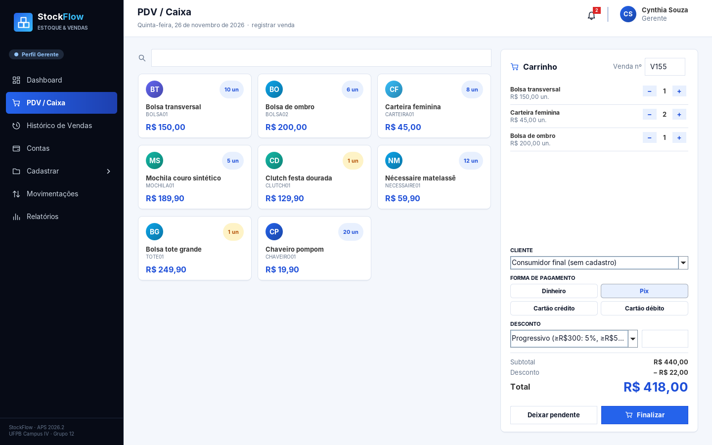
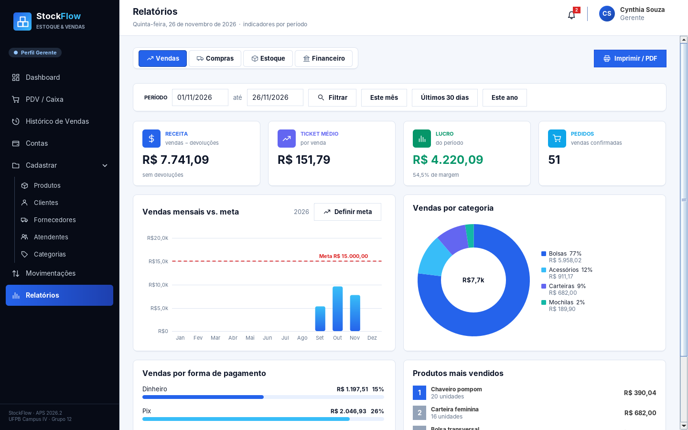
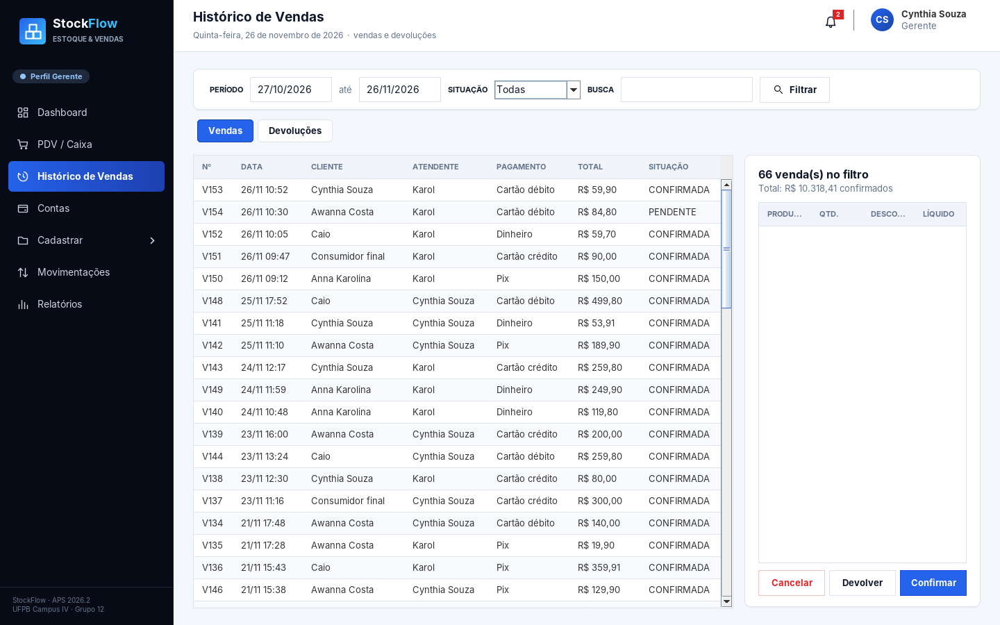
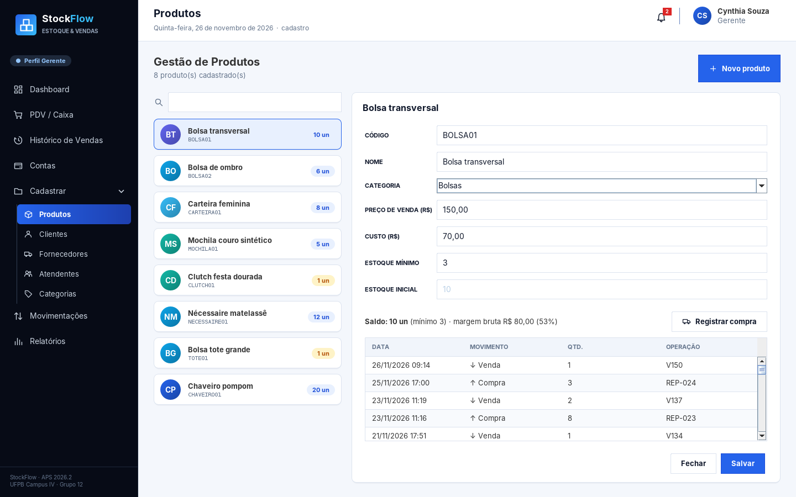

<div align="center">

# 📦 StockFlow — Sistema de Gestão de Estoque e Vendas

### 💜 APS • Grupo 12 • UFPB Campus IV • 2026.2


**Vendas, descontos, devoluções e estoque consistente — inclusive quando uma operação falha.**

[✨ Funcionalidades](#-funcionalidades) · [🏗️ Arquitetura](#%EF%B8%8F-arquitetura) · [🚀 Executar](#-executando-o-projeto) · [🧪 Testar](#-testes) · [👩‍💻 Equipe](#-equipe)

</div>

---

## 💜 O projeto

Este projeto foi desenvolvido como base para a **Unidade III de Análise e Projeto de Sistemas**, com orientação do **Prof. Dr. Dorgival Netto**, da **Universidade Federal da Paraíba — Campus IV**.

O desafio do **Grupo 12** é implementar **venda, baixa de estoque e devolução vinculada aos itens realmente vendidos**, impedindo devoluções acima da quantidade vendida ou processadas duas vezes. Também é necessário variar uma política de desconto e manter produtos, valores e movimentos consistentes quando ocorrer falha de persistência.

O tema foi definido pelo professor e utiliza como referência a documentação **Toda Chick Bolsas & Cia.** (semestre anterior), composta pela [modelagem de dados no Notion](https://app.notion.com/p/Toda-Chick-Bolsas-Cia-Modelagem-de-Dados-eed393f29c174fe2bb4fe00f53f3147d) e pelo [protótipo de interface no Figma](https://www.figma.com/make/1C28Lge3yXl9R2z64MKwFL/PROJETO-MODELAGEM-DE-DADOS).

**O que foi reaproveitado e o que foi adaptado:**

| Da referência Toda Chick | Neste projeto |
|---|---|
| Protótipo de telas (login, painel com total de produtos e alertas, estoque, vendas, relatórios) | Usado como **base funcional** das telas; a interface Swing tem **identidade visual própria** (StockFlow, azul-marinho/preto e azul) e layout diferente |
| Dois tipos de usuária: proprietária e atendente | Perfis `GERENTE` e `VENDEDOR`; login em `ServicoAutenticacao` com contas fictícias próprias; permissões verificadas no `ServicoLoja` |
| Catálogo de bolsas e acessórios, alerta de estoque baixo | 8 produtos fictícios (2 em alerta), `Produto.emAlerta()` e Observer `AlertaEstoqueMinimo` |
| Registro de vendas e relatórios | **Adaptado ao desafio do Grupo 12**: venda com estados, baixa atômica, devolução vinculada aos itens vendidos, políticas de desconto |

> As regras de devolução, idempotência e integridade **não vêm da documentação anterior**: são exigências do desafio do Grupo 12 nas orientações do professor e foram especificadas pela equipe em [requisitos](docs/requisitos.md).

### 🎯 O que o sistema resolve?

- Evita vender mais unidades do que existem em estoque.
- Garante que confirmar a mesma venda **duas vezes não dê duas baixas**.
- Impede devolução de um produto não vendido ou acima da quantidade comprada.
- Calcula desconto **percentual, fixo ou progressivo por faixa de valor**, além de reembolsos em **centavos inteiros**, sem erros de ponto flutuante.
- Usa **gravação atômica em CSV**: venda, saldo e histórico são substituídos juntos, ou o arquivo anterior permanece intacto.
- Diferencia permissões de **gerente (proprietária) e vendedor (atendente)**, verificadas no serviço.
- Possui **interface gráfica própria (StockFlow)** e, como alternativa, um modo console.

## ✨ Funcionalidades

| Caso de uso | O que está implementado (com persistência real) |
|:--|:--|
| **UC01 · Produtos, compras e estoque** | Cadastro/edição de produtos com categoria, preço e custo; **compra de fornecedor** que atualiza estoque, custo e movimentação numa única transação; alerta de estoque mínimo. |
| **UC02 · Vendas (PDV)** | Carrinho, cliente, forma de pagamento e desconto (percentual, fixo ou progressivo); venda `PENDENTE` → `CONFIRMADA` com baixa atômica, ou `CANCELADA`; confirmar de novo não repete a baixa. |
| **UC03 · Devoluções** | Só de venda confirmada, só de item vendido, até a quantidade vendida; reembolso pelo valor líquido; mesmo ID não processa duas vezes. |
| **UC04 · Gestão e relatórios** | Dashboard (faturamento e lucro de hoje/mês, meta mensal, vendas da semana, estoque baixo); relatórios de vendas, compras, estoque e financeiro por período; contas a pagar/receber; cadastros de clientes, fornecedores, categorias e atendentes. |

> Não há emissão fiscal nem pagamento real: forma de pagamento, reembolso e contas são registros simulados.

### 🔄 Ciclo de uma venda

<div>
  
</div>

### 👥 Perfis e permissões (verificadas nos serviços)

| Operação | Gerente | Atendente |
|---|:---:|:---:|
| PDV: abrir, confirmar e cancelar venda pendente | ✅ | ✅ |
| Histórico de vendas, contas (consulta), clientes (cadastrar/editar) | ✅ | ✅ |
| Devolução | ✅ | ❌ |
| Produtos, compras, fornecedores, categorias, atendentes | ✅ | ❌ |
| Excluir cliente, lançar/quitar/cancelar contas, meta mensal | ✅ | ❌ |
| Dashboard e relatórios financeiros | ✅ | ❌ |

**Contas de demonstração** (senha `stockflow2026`): `gerente@stockflow.demo` (Cynthia Souza, gerente) e `karol@stockflow.demo` (Karol, atendente). Novas atendentes podem ser cadastradas pela gerente em *Cadastrar → Atendentes*. O menu esconde o que o perfil não usa, mas quem **bloqueia** é a camada de serviço (`Autorizacao.exigir` / `ServicoLoja.autorizar`), inclusive no console.

### 🖥️ Interface gráfica

| Login | Dashboard (gerente) |
|---|---|
|  |  |
| **PDV / Caixa** (política via Factory Method) | **Relatórios** |
|  |  |
| **Histórico de vendas** | **Produtos** (compra, histórico do item) |
|  |  |

Outras telas: [contas](docs/telas/gerente-contas.png), [clientes](docs/telas/gerente-clientes.png), [fornecedores](docs/telas/gerente-fornecedores.png), [atendentes](docs/telas/gerente-atendentes.png), [categorias](docs/telas/gerente-categorias.png), [movimentações](docs/telas/gerente-movimentacoes.png), relatórios de [compras](docs/telas/gerente-relatorios-compras.png), [estoque](docs/telas/gerente-relatorios-estoque.png) e [financeiro](docs/telas/gerente-relatorios-financeiro.png); visão da atendente: [PDV](docs/telas/karol-pdv.png), [histórico](docs/telas/karol-historico.png), [contas](docs/telas/karol-contas.png), [clientes](docs/telas/karol-clientes.png).

## 🏗️ Arquitetura

Estrutura implementada em **Java 21**, usando arquitetura em camadas (MVC na interface), injeção de dependências por construtor e **cinco padrões GoF nas três categorias**.

<div>
  
</div>

| GoF | Categoria | Uso no sistema |
|---|---|---|
| **Factory Method** | Criação | `CriadorPoliticaDesconto.fabricar()` é sobrescrito por cada criador concreto; as telas escolhem um criador sem `if/else`. |
| **Strategy** | Comportamental | Política de desconto intercambiável: percentual, fixo e **progressivo (extensão)**. |
| **Observer** | Comportamental | Registra alerta quando estoque atinge o mínimo, somente após confirmação da operação. |
| **Facade** | Estrutural | `LojaFacade` é o único ponto de acesso das telas (gráfica e console) aos serviços. |
| **Adapter** | Estrutural | Adapta dados atuais ao exportador legado **simulado**. |

**Extensão demonstrável:** `DescontoPorFaixa` (≥ R$ 300 → 5%; ≥ R$ 500 → 10%) implementa `PoliticaDesconto` e ganhou o criador `CriadorDescontoPorFaixa`. Código **acrescentado**: essas duas classes + testes. Código **alterado**: uma linha em `CatalogoDescontos.padrao()` para registrar o criador. Código **reutilizado sem mudança**: `ServicoLoja`, `Venda`, `ItemVenda`, `PoliticaDesconto`, telas. Detalhes em [arquitetura](docs/arquitetura.md#extensão-do-strategy).

### 🗂️ Organização do código

```text
.
├── pom.xml
├── README.md
├── src/
│   ├── main/java/br/ufpb/aps/grupo12/
│   │   ├── aplicacao/      # App (montagem), ConsoleView, DadosDemo, RelogioAjustavel
│   │   ├── interfacegrafica/ # Telas Swing (View/Controller) do StockFlow
│   │   ├── seguranca/      # Usuario, ContasPersistidas, ServicoAutenticacao
│   │   ├── dominio/        # Produto, Venda, ItemVenda, Devolucao, Movimentacao
│   │   ├── servicos/       # ServicoLoja, ServicoCadastros, ServicoFinanceiro, ServicoRelatorios, LojaFacade
│   │   ├── persistencia/   # Contrato Repositorio, CSV atômico e RepositorioMemoria
│   │   ├── politicas/      # Strategy: percentual, fixo, progressivo
│   │   │   └── fabricas/   # Factory Method: criadores de políticas
│   │   ├── observadores/   # Observer de estoque mínimo
│   │   └── relatorios/     # Adapter e exportação legada simulada
│   └── test/java/br/ufpb/aps/grupo12/   # ServicoLojaTest, PadroesEExtensaoTest, GestaoCompletaTest
├── dados/                 # CSV gerado em execução, ignorado pelo Git
└── docs/                  # UML, regras, rastreabilidade, ADRs, testes, apresentação
```

## 🚀 Executando o projeto

**Pré-requisitos:** JDK 21 e Maven 3.9+ instalados. Não há dependência de banco externo nem de serviços pagos.

No terminal **dentro da pasta do projeto**, execute:

```bash
mvn clean compile
mvn exec:java
```

Abre a **janela gráfica** do StockFlow (tela de login). Para usar o menu de texto:

```bash
mvn exec:java -Dexec.args="--console"
```

Na primeira execução, o programa gera a **base de demonstração**: 8 produtos (2 em estoque baixo), 4 categorias, 4 clientes (nomes da equipe), 2 fornecedores, contas e cerca de 2,5 meses de vendas, compras e devoluções. Esse histórico é criado **executando as operações reais dos serviços** com semente fixa, então respeita todas as regras e é reprodutível (`--reset-demo` recria tudo). No Windows também há atalhos em `scripts/` (`iniciar-windows.bat`, `iniciar-console-windows.bat`, `reset-demo-windows.bat`, `testar-windows.bat`).

**Resetar para repetir os testes demonstrativos:**

```bash
mvn compile exec:java -Dexec.args="--reset-demo"
mvn exec:java
```

O reset **substitui os dados do arquivo de demonstração** — não execute em um arquivo que contenha dados que deseja preservar. Para comandos de PowerShell ou problemas no IntelliJ IDEA, consulte [validação](docs/validacao.md).

### 🧪 Testes

```bash
mvn clean test
```

Existem **49 cenários JUnit** em três classes: `ServicoLojaTest` (regras de venda, devolução, estoque, perfis, idempotência, falhas de commit, Strategy, Observer, Facade, Adapter), `PadroesEExtensaoTest` (Factory Method, extensão progressiva com fronteiras, autenticação, integração console → Facade) e `GestaoCompletaTest` (cliente/pagamento/data na venda, prévia sem gravação, compra atômica, exclusões bloqueadas por referência, estados das contas, lucro com devolução, meta, usuárias, reinício e leitura do formato CSV antigo, dados de demonstração). As duas mutações exigidas foram executadas e detectadas — ver [validação](docs/validacao.md).

Os resultados oficiais deverão ser capturados em `target/surefire-reports/`. Para dois defeitos introduzidos **temporariamente**, há um procedimento documentado em [validação e mutações](docs/validacao.md). O código entregue deve permanecer sem alterações intencionalmente incorretas.

## 📚 Documentação para o professor

| Documento | Conteúdo |
|---|---|
| [Especificação de requisitos](docs/requisitos.md) | UC01–UC04, RN01–RN11, perfis, fluxos, políticas, limites e critérios de aceitação. |
| [Arquitetura e padrões GoF](docs/arquitetura.md) | Responsabilidades, transação, alternativas, classes dos cinco padrões e extensão. |
| [Diagrama de classes UML (PlantUML)](docs/diagramas/classes.puml) | Atributos, visibilidades, métodos e relacionamentos. |
| [Fluxos e estados (Mermaid)](docs/diagramas/fluxos.md) | Estados da venda e fluxos de venda e devolução. |
| [Matriz de rastreabilidade](docs/rastreabilidade.md) | Cada regra ligada a métodos, testes e evidências de demonstração. |
| [Decisões arquiteturais (ADR)](docs/decisoes-adr.md) | Contexto, opções, decisão, consequências e evidências. |
| [Validação](docs/validacao.md) | Cenários reproduzíveis, falhas de commit e roteiro de duas mutações. |
| [Uso de IA](docs/uso-de-ia.md) | Declaração de auxílio e tabela de interações significativas a revisar. |
| [Roteiro da 1ª parcial](docs/apresentacao_parcial_12-11.md) | Apresentação de 12/11, com distribuição sugerida de 5 minutos. |
| [Roteiro final](docs/apresentacao_final_08-12.md) | Apresentação de 08/12, com demonstração e possíveis perguntas. |
| [Slides da 1ª parcial](apresentacao_1a_parcial_12-11.pptx) | Apresentação editável (6 slides, roxo e rosa), acompanhada de roteiro. |
| [Telas da interface](docs/telas/) | Capturas da interface gráfica com dados de demonstração. |
| [Guia IntelliJ/GitHub](docs/guia-intellij-github.md) | Importação no Windows, testes, colaboração e push. |
| [Evidência de mutações](docs/evidencias-mutacoes-local.txt) | Dois defeitos introduzidos em cópia temporária, detectados pelos testes e restaurados. |

## ⚠️ Limitações conhecidas

- Login com contas fictícias; a gerente cadastra/desativa atendentes, mas não há recuperação de senha nem troca de senha.
- Os alertas do Observer ficam em memória durante a sessão; o estado do estoque, esse sim, é persistido.
- O CSV atômico depende de `ATOMIC_MOVE` no sistema de arquivos local; não é solução para várias máquinas.
- Pagamento, reembolso e contas são registros simulados: não há integração com banco, maquininha nem nota fiscal.
- O botão *Imprimir / PDF* usa a impressão do sistema (no Windows, escolha “Microsoft Print to PDF”).
- As datas dos dados de demonstração são relativas ao dia em que `--reset-demo` é executado.
- Devolução repõe o produto direto ao estoque vendável (sem triagem de avaria).

## 👩‍💻 Equipe

<div align="center">

| Integrante | GitHub | E-mail acadêmico | Foto |
|---|---|---|---|
| **Anna Karolina** | *Adicionar perfil* | *Adicionar* | *Adicionar* |
| **Awanna Costa** | *Adicionar perfil* | *Adicionar* | *Adicionar* |
| **Cynthia Souza** | *Adicionar perfil* | *Adicionar* | *Adicionar* |
| **Caio** | *Adicionar perfil* | *Adicionar* | *Adicionar* |


**Disciplina:** Análise e Projeto de Sistemas · **Professor:** Dr. Dorgival Netto  
**Instituição:** Universidade Federal da Paraíba (UFPB), Campus IV

</div>
---

💜 *Feito por Equipe 12.*

</div>
