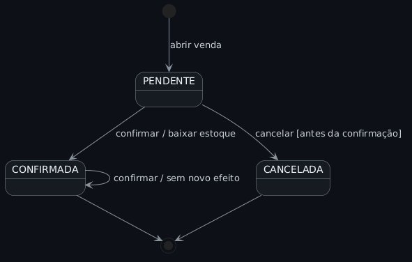

<div align="center">

# 🛍️ Sistema de Gestão de Estoque e Vendas

### 💜 APS • Grupo 12 • UFPB Campus IV • 2026.2


**Vendas, descontos, devoluções e estoque consistente — inclusive quando uma operação falha.**

[✨ Funcionalidades](#-funcionalidades) · [🏗️ Arquitetura](#%EF%B8%8F-arquitetura) · [🚀 Executar](#-executando-o-projeto) · [🧪 Testar](#-testes) · [👩‍💻 Equipe](#-equipe)

</div>

---

## 💜 O projeto

Este projeto foi desenvolvido como base para a **Unidade III de Análise e Projeto de Sistemas**, com orientação do **Prof. Dr. Dorgival Netto**, da **Universidade Federal da Paraíba — Campus IV**.

O desafio do **Grupo 12** é implementar **venda, baixa de estoque e devolução vinculada aos itens realmente vendidos**, impedindo devoluções acima da quantidade vendida ou processadas duas vezes. Também é necessário variar uma política de desconto e manter produtos, valores e movimentos consistentes quando ocorrer falha de persistência.

O tema foi definido pelo professor e deve utilizar como referência a documentação **Toda Chick Bolsas & Cia.**. **Essa documentação anterior ainda não foi disponibilizada neste projeto:** a especificação inicial foi construída a partir das orientações oficiais da disciplina e deve ser revisada pela equipe ao receber o arquivo de referência.

### 🎯 O que o sistema resolve?

- Evita vender mais unidades do que existem em estoque.
- Garante que confirmar a mesma venda **duas vezes não dê duas baixas**.
- Impede devolução de um produto não vendido ou acima da quantidade comprada.
- Calcula desconto **percentual ou fixo**, além de reembolsos em **centavos inteiros**, sem erros de ponto flutuante.
- Usa **gravação atômica em CSV**: venda, saldo e histórico são substituídos juntos, ou o arquivo anterior permanece intacto.
- Diferencia permissões de **gerente e vendedor**, verificadas no serviço.

## ✨ Funcionalidades

| Caso de uso | Fluxos da versão inicial |
|:--|:--|
| **UC01 · Produtos e estoque** | Cadastrar, consultar e registrar reposição sem duplicidade de lançamento. |
| **UC02 · Vendas** | Abrir em `PENDENTE`, calcular descontos, confirmar com baixa atômica e cancelar pendentes. |
| **UC03 · Devoluções** | Validar venda confirmada, impedir excesso, calcular restituição e repor estoque uma única vez. |
| **UC04 · Consultas e relatórios** | Consultar estoque, movimentos, vendas e receita líquida simulada; exportar relatório legado simulado. |

> As funcionalidades têm regras de sucesso e falha. Não há emissão fiscal, pagamento real nem autenticação de usuários; o console permite **selecionar um perfil apenas para a demonstração acadêmica**.

### 🔄 Ciclo de uma venda

<div>
  
</div>

### 👥 Permissões

| Operação | Gerente | Vendedor(a) |
|---|:---:|:---:|
| Consultar estoque, movimentações e relatório | ✅ | ✅ |
| Abrir/confirmar/cancelar venda pendente | ✅ | ✅ |
| Cadastrar produto e repor estoque | ✅ | ❌ |
| Registrar devolução | ✅ | ❌ |

## 🏗️ Arquitetura

Estrutura implementada em **Java 21**, usando arquitetura em camadas, injeção de dependências por construtor e quatro padrões de projeto **GoF** em duas categorias.

<div>
  
</div>

| GoF | Categoria | Uso no sistema |
|---|---|---|
| **Strategy** | Comportamental | Troca política de desconto percentual por fixo. |
| **Observer** | Comportamental | Registra alerta quando estoque atinge mínimo, após confirmação da operação. |
| **Facade** | Estrutural | Simplifica o conjunto de serviços acessados pela interface. |
| **Adapter** | Estrutural | Adapta dados atuais ao exportador legado **simulado**. |

**Extensão demonstrável:** `DescontoFixo` implementa `PoliticaDesconto`; o serviço `ServicoLoja.abrirVenda()` continua usando o contrato comum, sem alteração. Consulte [arquitetura e decisão de extensão](../../Downloads/APS_Grupo12_Projeto_Java_Documentacao_e_Slides/APS_Grupo12/docs/arquitetura.md).

### 🗂️ Organização do código

```text
.
├── pom.xml
├── README.md
├── src/
│   ├── main/java/br/ufpb/aps/grupo12/
│   │   ├── aplicacao/      # Console e montagem de dependências
│   │   ├── dominio/        # Produto, Venda, ItemVenda, Devolucao, Movimentacao
│   │   ├── servicos/       # Casos de uso e Facade
│   │   ├── persistencia/   # Contrato Repositorio e CSV atômico
│   │   ├── politicas/      # Strategy percentual e fixo
│   │   ├── observadores/   # Observer de estoque mínimo
│   │   └── relatorios/     # Adapter e exportação legada simulada
│   └── test/java/br/ufpb/aps/grupo12/ServicoLojaTest.java
├── dados/                 # CSV gerado em execução, ignorado pelo Git
└── docs/                  # UML, regras, rastreabilidade, ADRs, testes, apresentação
```

## 🚀 Executando o projeto

**Pré-requisitos:** JDK 21 e Maven 3.9+ instalados. Não há dependência de banco externo nem de serviços pagos.

No terminal **dentro da pasta do projeto**, execute:

```bash
mvn clean compile
mvn exec:java
```

Na primeira execução, o programa carrega **3 produtos fictícios**. É possível escolher o perfil e executar as operações em um menu.

**Resetar para repetir os testes demonstrativos:**

```bash
mvn compile exec:java -Dexec.args="--reset-demo"
mvn exec:java
```

O reset **substitui os dados do arquivo de demonstração** — não execute em um arquivo que contenha dados que deseja preservar. Para comandos de PowerShell ou problemas no IntelliJ IDEA, consulte [validação](../../Downloads/APS_Grupo12_Projeto_Java_Documentacao_e_Slides/APS_Grupo12/docs/validacao.md).

### 🧪 Testes

```bash
mvn clean test
```

Existem **27 cenários JUnit** que cobrem regras de negócio, valores de fronteira, perfis, estados, idempotência, persistência real, falhas injetadas de commit e os quatro padrões. O código Java e uma execução local alternativa dos 27 cenários foram verificados durante a preparação; **a execução oficial com Maven/JUnit permanece para ser confirmada pela equipe** (não estava disponível no ambiente de preparação). Não confundir esse resultado preliminar com o relatório final do Maven.

Os resultados oficiais deverão ser capturados em `target/surefire-reports/`. Para dois defeitos introduzidos **temporariamente**, há um procedimento documentado em [validação e mutações](../../Downloads/APS_Grupo12_Projeto_Java_Documentacao_e_Slides/APS_Grupo12/docs/validacao.md). O código entregue deve permanecer sem alterações intencionalmente incorretas.

## 📚 Documentação para o professor

| Documento | Conteúdo |
|---|---|
| [Especificação de requisitos](../../Downloads/APS_Grupo12_Projeto_Java_Documentacao_e_Slides/APS_Grupo12/docs/requisitos.md) | UC01–UC04, RN01–RN11, perfis, fluxos, políticas, limites e critérios de aceitação. |
| [Arquitetura e padrões GoF](../../Downloads/APS_Grupo12_Projeto_Java_Documentacao_e_Slides/APS_Grupo12/docs/arquitetura.md) | Responsabilidades, transação, alternativas, classes dos quatro padrões e extensão. |
| [Diagrama de classes UML (PlantUML)](../../Downloads/APS_Grupo12_Projeto_Java_Documentacao_e_Slides/APS_Grupo12/docs/diagramas/classes.puml) | Atributos, visibilidades, métodos e relacionamentos. |
| [Fluxos e estados (Mermaid)](../../Downloads/APS_Grupo12_Projeto_Java_Documentacao_e_Slides/APS_Grupo12/docs/diagramas/fluxos.md) | Estados da venda e fluxos de venda e devolução. |
| [Matriz de rastreabilidade](../../Downloads/APS_Grupo12_Projeto_Java_Documentacao_e_Slides/APS_Grupo12/docs/rastreabilidade.md) | Cada regra ligada a métodos, testes e evidências de demonstração. |
| [Quatro decisões arquiteturais](../../Downloads/APS_Grupo12_Projeto_Java_Documentacao_e_Slides/APS_Grupo12/docs/decisoes-adr.md) | Contexto, opções, decisão, consequências e evidências. |
| [Validação](../../Downloads/APS_Grupo12_Projeto_Java_Documentacao_e_Slides/APS_Grupo12/docs/validacao.md) | Cenários reproduzíveis, falhas de commit e roteiro de duas mutações. |
| [Uso de IA](../../Downloads/APS_Grupo12_Projeto_Java_Documentacao_e_Slides/APS_Grupo12/docs/uso-de-ia.md) | Declaração de auxílio e tabela de interações significativas a revisar. |
| [Roteiro da 1ª parcial](../../Downloads/APS_Grupo12_Projeto_Java_Documentacao_e_Slides/APS_Grupo12/docs/apresentacao_parcial_12-11.md) | Apresentação de 12/11, com distribuição sugerida de 5 minutos. |
| [Roteiro final](../../Downloads/APS_Grupo12_Projeto_Java_Documentacao_e_Slides/APS_Grupo12/docs/apresentacao_final_08-12.md) | Apresentação de 08/12, com demonstração e possíveis perguntas. |
| [Slides da 1ª parcial](apresentacao_1a_parcial_12-11.pptx) | Apresentação editável (6 slides, roxo e rosa), acompanhada de roteiro. |
| [Guia IntelliJ/GitHub](../../Downloads/APS_Grupo12_Projeto_Java_Documentacao_e_Slides/APS_Grupo12/docs/guia-intellij-github.md) | Importação no Windows, testes, colaboração e push. |
| [Evidência técnica preliminar de mutações](../../Downloads/APS_Grupo12_Projeto_Java_Documentacao_e_Slides/APS_Grupo12/docs/evidencias-mutacoes-local.txt) | Dois defeitos detectados em cópias temporárias, sem execução oficial Maven. |

## 👩‍💻 Equipe

<div align="center">

| Integrante | GitHub | E-mail acadêmico | Foto |
|---|---|---|---|
| **Anna Karolina** | *Adicionar perfil* | *Adicionar* | *Adicionar* |
| **Awanna Costa** | *Adicionar perfil* | *Adicionar* | *Adicionar* |
| **Cynthia Souza** | *Adicionar perfil* | *Adicionar* | *Adicionar* |
| **Caio** | *Adicionar perfil* | *Adicionar* | *Adicionar* |


**Disciplina:** Análise e Projeto de Sistemas · **Professor:** Dr. Dorgival Netto  
**Instituição:** Universidade Federal da Paraíba (UFPB), Campus IV

</div>
---

💜 *Feito por Equipe 12.*

</div>
