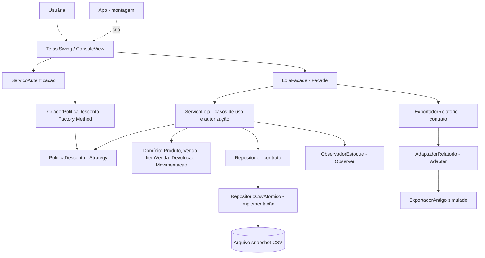
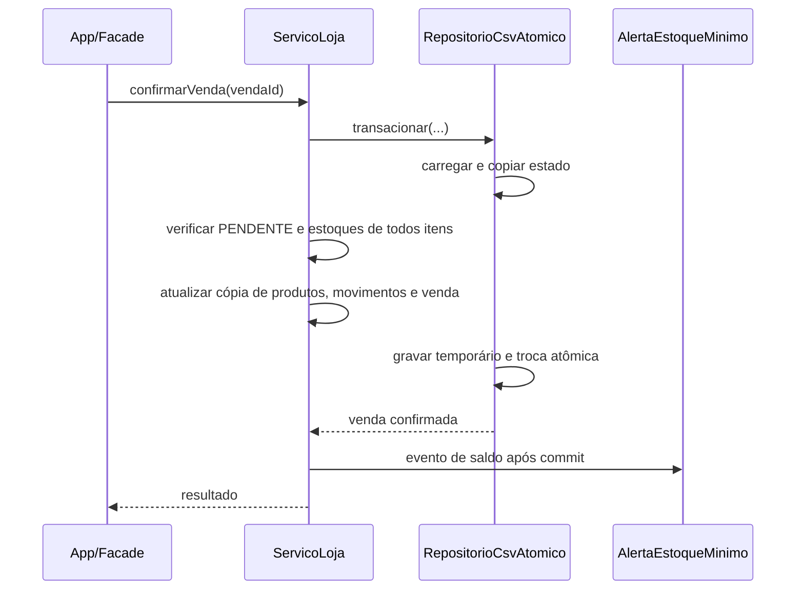

# Arquitetura e padrões de projeto — Grupo 12

## Visão geral

Java 21, aplicação com **interface gráfica Swing** (e modo console alternativo), arquitetura em camadas com contratos injetados por construtor e **persistência CSV real**. As regras de negócio pertencem ao `ServicoLoja` e aos objetos imutáveis em `dominio`. As telas (`interfacegrafica`) e o `ConsoleView` chamam apenas a `LojaFacade`, sem manipular arquivo nem calcular regras. O `App` somente monta os componentes e escolhe a interface.

### Responsabilidades e dependências

| Pacote | Responsabilidade | Exemplo |
|---|---|---|
| `dominio` | Estado, invariantes, dinheiro em centavos e entidades imutáveis | `Venda.comEstado`, `ItemVenda.restituiAte` |
| `servicos` | Casos de uso e autorização no backend, orquestração transacional | `ServicoLoja.confirmarVenda` |
| `persistencia` | Contrato e gravação atômica com isolamento por cópia e lock | `Repositorio`, `RepositorioCsvAtomico` |
| `politicas` | Estratégias intercambiáveis de desconto | `DescontoPercentual`, `DescontoFixo` |
| `observadores` | Alertas após gravação bem-sucedida | `AlertaEstoqueMinimo` |
| `relatorios` | Tradução para contrato legado simulado | `AdaptadorRelatorio` |
| `aplicacao` | Montagem das dependências (`App`), view de texto (`ConsoleView`), geração da base de demonstração (`DadosDemo`) e relógio ajustável | `App.main`, `DadosDemo.restaurar` |
| `servicos` (novos) | `ServicoCadastros` (clientes, fornecedores, categorias, usuárias), `ServicoFinanceiro` (contas, meta), `ServicoRelatorios` (dashboard e relatórios, só leitura) | `ServicoRelatorios.resumo` |
| `interfacegrafica` | Views/controladores Swing: recebem comandos, chamam a Facade, exibem resultado e erros | `PaginaPdv`, `PaginaHistorico` |
| `politicas.fabricas` | Factory Method: criadores das políticas de desconto | `CriadorPoliticaDesconto.fabricar` |
| `seguranca` | Identificação da usuária (login de demonstração) → perfil | `ServicoAutenticacao.entrar` |

## Transação atômica em CSV

1. Abrir arquivo auxiliar `.lock` para serializar acesso de processos que usam esse repositório.
2. Ler **snapshot CSV atual**; criar uma cópia das entidades (records imutáveis).
3. Rodar validações e aplicação das alterações **na cópia**. Se ocorrer exceção, nenhuma escrita no arquivo original.
4. Serializar a cópia inteira num `.tmp` **no mesmo diretório** e forçar gravação (`FileChannel.force(true)`).
5. Trocar o arquivo antigo pelo novo por `Files.move(..., ATOMIC_MOVE, REPLACE_EXISTING)`.
6. Notificar observadores **somente após** o retorno bem-sucedido da transação.

**Justificativa:** um único snapshot evita inconsistência entre múltiplos CSVs. Um `.tmp` incompleto nunca substitui o arquivo original. Caso `ATOMIC_MOVE` seja indisponível no sistema de arquivos, a operação falha explicitamente (sem gravação parcial). Há bloqueio por arquivo no armazenamento local; **não é uma solução distribuída nem de escala de produção**. É uma escolha proporcional ao trabalho acadêmico e à demonstração de tudo-ou-nada.

Os arquivos CSV usam linhas tipadas `P` (produto), `V` (venda), `I` (item), `D` (devolução), `M` (movimentação). Campos textuais que poderiam conter delimitadores são codificados em Base64 URL-safe e recuperados ao ler. Os dados demonstráveis são restaurados com `--reset-demo`.

### Exemplo de confirmação atômica

## Padrões GoF — problema real, alternativa, classes, código e evidência

| Padrão | Categoria | Problema e alternativa | Decisão: classes e local no código | Benefício | Teste |
|---|---|---|---|---|---|
| **Strategy** | Comportamento | Desconto muda entre percentual e fixo; alternativa: `if/else` no serviço. | `PoliticaDesconto`, `DescontoPercentual`, `DescontoFixo`; `ServicoLoja.abrirVenda` recebe estratégia. | Novas políticas não exigem editar o serviço. | `descontoPercentualCalculaValorCorreto`, `strategyFixoEhExtensaoSemModificarServico` |
| **Observer** | Comportamento | Alertar saldo mínimo sem misturar alertas à transação; alternativa: log direto no serviço. | `ObservadorEstoque`, `EventoEstoque`, `AlertaEstoqueMinimo`, `ServicoLoja.publicarDepoisDoCommit`. | Serviços continuam desacoplados dos alertas; eventos somente após sucesso. | `observerSoRecebeEventoAposCommitEAlertaEstoqueMinimo` |
| **Facade** | Estrutura | O console teria de conhecer os métodos e subsistemas; alternativa: chamar cada subsistema diretamente. | `LojaFacade`, utilizada por `App`; expõe `abrirVenda`, `confirmar`, `devolver`, `estoque`, `relatorio`. | API simplificada para interface sem deslocar regras. | `facadeEncaminhaFluxoCompletoParaOsServicos` |
| **Factory Method** | Criação | A interface precisava montar a política com `if/else` (“1 = percentual, 2 = fixo”) conhecendo construtores e conversões; alternativa: seleção estática por `switch` numa classe utilitária (o professor indica que isso não basta). | `CriadorPoliticaDesconto` (Creator, com `criar()` final e `fabricar()` abstrato), `CriadorDescontoPercentual`, `CriadorDescontoFixo`, `CriadorDescontoPorFaixa` (Concrete Creators), `PoliticaDesconto` (Product), `CatalogoDescontos`; usados em `PaginaPdv.registrar e PaginaPdv.criarPolitica` e `ConsoleView.abrirVenda`. | Telas não têm `if/else` de política; nova opção = novo criador registrado no `App`/catálogo. | `factoryMethodCadaCriadorConcretoProduzSuaPolitica`, `factoryMethodPermiteNovoCriadorSobrescrevendoApenasFabricar`, `factoryMethodRejeitaParametroInvalidoSemCriarVenda` |
| **Adapter** | Estrutura | Relatório atual precisa trabalhar com contrato de API legada simulada que espera `List<String[]>`; alternativa: exportação acoplada ao domínio. | `ExportadorRelatorio`, `AdaptadorRelatorio`, `ExportadorAntigo` (simulado). | Reutiliza formato legado sem alterar entidades. | `adapterExportaRelatorioParaFormatoLegado` |

### Extensão do Strategy

**Nova opção:** `DescontoPorFaixa` — desconto progressivo pelo valor da compra (a partir de R$ 300,00 → 5%; a partir de R$ 500,00 → 10%; abaixo disso, 0).

| Código | Situação |
|---|---|
| `politicas/DescontoPorFaixa.java` | **Acrescentado** (Strategy concreta) |
| `politicas/fabricas/CriadorDescontoPorFaixa.java` | **Acrescentado** (Creator concreto) |
| `PadroesEExtensaoTest` (fronteiras e uso no serviço) | **Acrescentado** |
| `CatalogoDescontos.padrao()` | **Alterado**: uma linha para registrar o novo criador |
| `ServicoLoja.abrirVenda`, `distribuirDesconto`, `Venda`, `ItemVenda`, `PoliticaDesconto`, `PaginaPdv`, `ConsoleView` | **Reutilizados sem alteração** — a opção aparece sozinha no combo/menu |

**Demonstração:** no *PDV / Caixa*, escolher “Progressivo”, vender 2 × BOLSA01 (R$ 300,00 → desconto R$ 15,00) e depois 1 × BOLSA01 (R$ 150,00 → sem desconto). Testes: `descontoProgressivoRespeitaFronteirasDasFaixas` (R$ 299,99 / 300,00 / 499,99 / 500,00) e `extensaoProgressivaFuncionaNoServicoSemAlterarSeuContrato` (inclui devolução com reembolso pelo valor líquido).

> `DescontoFixo` foi a primeira extensão (percentual → fixo); `DescontoPorFaixa` é a extensão feita junto com o Factory Method.

## Relógio injetado e dados de demonstração

Os serviços recebem um `java.time.Clock` pelo construtor. Em produção é o relógio do sistema; nos testes e no `DadosDemo` é um `RelogioAjustavel`, o que permite gerar ~2,5 meses de histórico **executando as operações reais** (compras, vendas, confirmações, devoluções e contas) sobre um `RepositorioMemoria` e gravar o resultado no CSV numa única transação. Assim os dados de demonstração nunca violam as regras, e os testes de lucro/meta usam datas fixas.

## Persistência versão 2

O snapshot CSV passou a `APS_CSV,2`, com novas linhas `G` (categoria), `C` (cliente), `F` (fornecedor), `U` (usuária), `K` (compra), `A` (conta) e `X` (configuração), e novas colunas em `P`, `V`, `I`, `D` e `M` (custo, categoria, cliente, pagamento, datas). Arquivos da versão 1 continuam legíveis (teste `todosOsCadastrosSobrevivemAoReinicioEArquivoVersao1AindaEhLido`); a gravação é sempre atômica, como antes.

## Interface gráfica (MVC)

- **View/Controller:** `JanelaLogin`, `JanelaPrincipal` (menu por perfil, barra superior com alertas) e as páginas `PaginaDashboard`, `PaginaPdv`, `PaginaHistorico`, `PaginaContas`, `PaginaProdutos`, `PaginaClientes`, `PaginaFornecedores`, `PaginaAtendentes`, `PaginaCategorias`, `PaginaMovimentacoes` e `PaginaRelatorios`. As telas de cadastro reutilizam `PaginaListaDetalhe<T>` (lista + formulário). Gráficos (`Graficos`) e ícones (`Icone`) são desenhados em Java2D, sem bibliotecas.
- **Model:** domínio + serviços. Nenhuma tela calcula desconto, total, reembolso, lucro ou permissão: o total do carrinho vem de `simularVenda`, e todos os indicadores e gráficos vêm de `ServicoRelatorios`.
- **Erros:** `Tema.executar` mostra `ErroNegocio` como aviso compreensível e registra no log qualquer falha inesperada (ex.: persistência) com a causa — não há `catch` vazio.
- **Autorização:** o menu mostra a cada perfil só as telas que ele usa (como no protótipo), mas a proteção real está nos serviços: dentro das telas comuns (Histórico, Contas, Clientes), quando a atendente tenta devolver, quitar ou excluir, o serviço recusa e a mensagem aparece.
- **Identidade visual:** própria (StockFlow, azul-marinho/preto com azul elétrico). O protótipo Toda Chick serviu de base apenas para *quais* telas e informações eram necessárias.

**Nota acadêmica:** os cinco padrões são demonstrados com testes comportamentais, não apenas nomes de classes. Os diagramas em `docs/diagramas/classes.puml` evidenciam associações e dependências.

## Limitações conhecidas

- Login apenas com duas contas fictícias fixas (`ContasDemo`), sem cadastro de usuários; as permissões continuam validadas no serviço.
- Arquivo CSV atomizado exige suporte do sistema de arquivos local a renomeação atômica. A solução não aborda queda de energia depois do `move` sem sincronização da pasta, nem sistemas de arquivos de rede.
- Valores e centavos representam simulação didática de venda e devolução, não cobrança/estorno real.
- Não há emissão de nota fiscal ou interoperabilidade com o comércio real.
