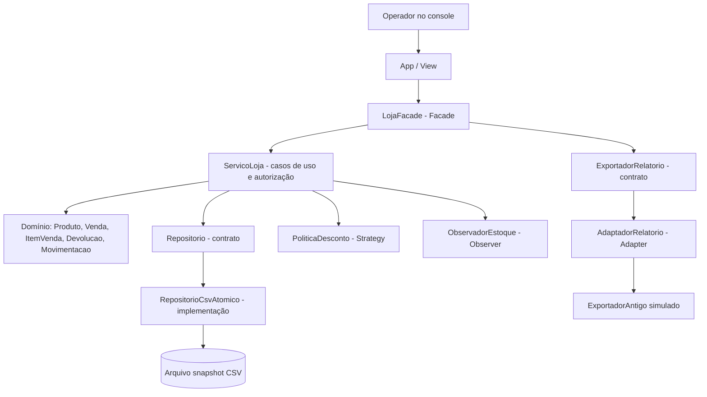
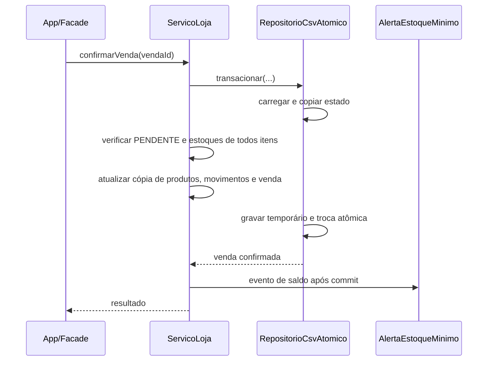

# Arquitetura e padrões de projeto — Grupo 12

## Visão geral

Java 21, aplicação em console, arquitetura em camadas com contratos injetados por construtor e **persistência CSV real**. As regras de negócio pertencem ao `ServicoLoja` e aos objetos imutáveis em `dominio`. O console chama `LojaFacade` sem manipular arquivo. O `App` somente monta os componentes e recebe comandos.

### Responsabilidades e dependências

| Pacote | Responsabilidade | Exemplo |
|---|---|---|
| `dominio` | Estado, invariantes, dinheiro em centavos e entidades imutáveis | `Venda.comEstado`, `ItemVenda.restituiAte` |
| `servicos` | Casos de uso e autorização no backend, orquestração transacional | `ServicoLoja.confirmarVenda` |
| `persistencia` | Contrato e gravação atômica com isolamento por cópia e lock | `Repositorio`, `RepositorioCsvAtomico` |
| `politicas` | Estratégias intercambiáveis de desconto | `DescontoPercentual`, `DescontoFixo` |
| `observadores` | Alertas após gravação bem-sucedida | `AlertaEstoqueMinimo` |
| `relatorios` | Tradução para contrato legado simulado | `AdaptadorRelatorio` |
| `aplicacao` | Montagem das dependências e interface de console | `App` |

## Transação atômica em CSV

1. Abrir arquivo auxiliar `.lock` para serializar acesso de processos que usam esse repositório.
2. Ler **snapshot CSV atual**; criar uma cópia das entidades (records imutáveis).
3. Rodar validações e aplicação das alterações **na cópia**. Se ocorrer exceção, nenhuma escrita no arquivo original.
4. Serializar a cópia inteira num `.tmp` **no mesmo diretório** e forçar gravação (`FileChannel.force(true)`).
5. Trocar o arquivo antigo pelo novo por `Files.move(..., ATOMIC_MOVE, REPLACE_EXISTING)`.
6. Notificar observadores **somente após** o retorno bem-sucedido da transação.

**Justificativa:** um único snapshot evita inconsistência entre múltiplos CSVs. Um `.tmp` incompleto nunca substitui o arquivo original. Caso `ATOMIC_MOVE` seja indisponível no sistema de arquivos, a operação falha explicitamente (sem gravação parcial). Há bloqueio por arquivo no armazenamento local; **não é uma solução distribuída nem de escala de produção**. É uma escolha proporcional ao trabalho acadêmico e à demonstração de tudo-ou-nada.

Os arquivos CSV usam linhas tipadas `P` (produto), `V` (venda), `I` (item), `D` (devolução), `M` (movimentação). Campos textuais que poderiam conter delimitadores são codificados em Base64 URL-safe e recuperados ao ler. Os dados demonstráveis são restaurados com `--reset-demo`.

### Exemplo de confirmação atômica

## Padrões GoF — problema real, alternativa, classes, código e evidência

| Padrão | Categoria | Problema e alternativa | Decisão: classes e local no código | Benefício | Teste |
|---|---|---|---|---|---|
| **Strategy** | Comportamento | Desconto muda entre percentual e fixo; alternativa: `if/else` no serviço. | `PoliticaDesconto`, `DescontoPercentual`, `DescontoFixo`; `ServicoLoja.abrirVenda` recebe estratégia. | Novas políticas não exigem editar o serviço. | `descontoPercentualCalculaValorCorreto`, `strategyFixoEhExtensaoSemModificarServico` |
| **Observer** | Comportamento | Alertar saldo mínimo sem misturar alertas à transação; alternativa: log direto no serviço. | `ObservadorEstoque`, `EventoEstoque`, `AlertaEstoqueMinimo`, `ServicoLoja.publicarDepoisDoCommit`. | Serviços continuam desacoplados dos alertas; eventos somente após sucesso. | `observerSoRecebeEventoAposCommitEAlertaEstoqueMinimo` |
| **Facade** | Estrutura | O console teria de conhecer os métodos e subsistemas; alternativa: chamar cada subsistema diretamente. | `LojaFacade`, utilizada por `App`; expõe `abrirVenda`, `confirmar`, `devolver`, `estoque`, `relatorio`. | API simplificada para interface sem deslocar regras. | `facadeEncaminhaFluxoCompletoParaOsServicos` |
| **Adapter** | Estrutura | Relatório atual precisa trabalhar com contrato de API legada simulada que espera `List<String[]>`; alternativa: exportação acoplada ao domínio. | `ExportadorRelatorio`, `AdaptadorRelatorio`, `ExportadorAntigo` (simulado). | Reutiliza formato legado sem alterar entidades. | `adapterExportaRelatorioParaFormatoLegado` |

### Extensão do Strategy

**Antes:** `DescontoPercentual` era uma implementação de `PoliticaDesconto`.  
**Depois:** acrescenta-se `DescontoFixo`, que implementa a mesma interface.  
**Código acrescentado:** `DescontoFixo.java` e seu teste.  
**Código reutilizado sem mudança:** `ServicoLoja.abrirVenda`, `Venda`, `ItemVenda`, contrato `PoliticaDesconto`.  
**Código ajustado para seleção na interface:** `App`, para oferecer a escolha entre percentagem e valor fixo.  
**Demonstração:** testar R$ 100,00 com 10% (= R$ 10,00 de desconto) e com desconto fixo de R$ 23,50, mostrando os dois resultados no console ou testes.

**Nota acadêmica:** os quatro padrões são demonstrados com testes comportamentais, não apenas nomes de classes. Os diagramas em `docs/diagramas/classes.puml` evidenciam associações e dependências.

## Limitações conhecidas

- Console não verifica identidade por login: o perfil é selecionado pelo operador, apesar de permissões serem validadas dentro do serviço.
- Arquivo CSV atomizado exige suporte do sistema de arquivos local a renomeação atômica. A solução não aborda queda de energia depois do `move` sem sincronização da pasta, nem sistemas de arquivos de rede.
- Valores e centavos representam simulação didática de venda e devolução, não cobrança/estorno real.
- Não há emissão de nota fiscal ou interoperabilidade com o comércio real.
